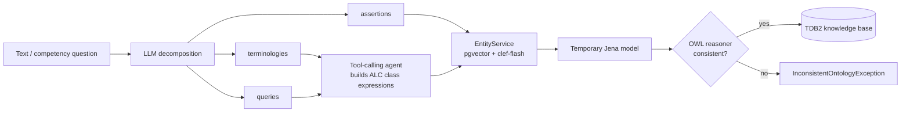

# TASP — Tool-Augmented Semantic Parser


TASP turns natural language into OWL ontology axioms. An LLM decomposes the text into
terminological knowledge, assertions and queries; a tool-calling agent builds the class
expressions; and every mentioned entity is grounded to a stable IRI through vector search and a fast decision model (`clef-flash` served by Ollama).
Axioms are checked with an OWL reasoner and persisted in an Apache Jena TDB2 knowledge base.

## How it works



1. **Decomposition** — `OntologicalDecompositionAiService` asks the LLM for a structured
   `OntologicalDecomposition`:
   - `assertions`: `CLASS_MEMBERSHIP` (individual, class) and `OBJECT_PROPERTY` (subject, property, object) facts;
   - `terminologies`: relations between concept statements (`SUBCLASS_OF`, `EQUIVALENT_TO`, `EQUALS_TO`);
   - `queries`: questions expressed as concept statements.
2. **Expression building** — nested concept statements are turned into class expressions by an LLM
   agent that calls tools (`ALCTools`): named class, top, intersection, union and existential
   restriction. An `ExpressionBuilder` keeps a tree with arity and a stack of open nodes, so
   arbitrarily nested expressions are supported. Incomplete expressions are retried (up to 3 times).
3. **Entity grounding** — `EntityService` embeds each description (all-MiniLM-L6-v2) and retrieves the
   nearest entities from PostgreSQL/pgvector (cosine distance). `EntityClassifier` then asks
   [`clef-flash`](https://ollama.com/library/clef-flash), a small Cloudflare decision model served by
   Ollama, to pick one candidate: the candidates plus a `none` option are the options of a `choice`
   question sent to Ollama's `/v1/systemone` endpoint through `OllamaDecisionModel`, a LangChain4j
   `DecisionModel`. The probability of the chosen option must reach the confidence threshold.
   When it does not, the decision is **not** taken by another LLM that lacks the context:
   - `EXPAND` is handled internally. If the classifier chose `none`, the search is repeated over twice
     as many candidates and the confidence threshold is multiplied by `expand-threshold-factor`
     (capped at 0.99), for at most `max-iterations` rounds. If nothing fits, the entity is stored with a
     generated IRI when writing is allowed, otherwise the request fails.
   - `REFINE` goes back to the agent. If a candidate stands out but is below the threshold, the
     description is ambiguous: the tool call fails with an error listing the nearest candidates, and the
     agent that issued it, which knows what the description means, calls again with a more specific one.
     No attempts are counted.

   Descriptions coming straight from the decomposition (assertions) cannot be refined: an unsure match
   is stored as a new entity.
4. **Validation and commit** — axioms are accumulated in a temporary Jena `OntModel` (ontapi).
   After each competency question the model merged with the knowledge base is checked with the
   Jena OWL reasoner. Only if every question is valid are the axioms committed to the TDB2
   default graph; otherwise nothing is written.

## Requirements

- JDK 25
- PostgreSQL with the [pgvector](https://github.com/pgvector/pgvector) extension
- An OpenAI API key (decomposition and class-expression building)
- [Ollama](https://ollama.com) 0.35.1 or later with the `clef-flash` model (entity selection)

## Quick start

Pull the entity-selection model (Ollama must be running: entity resolution fails without it):

```bash
ollama pull clef-flash
```

Start PostgreSQL with pgvector and enable the extension (Hibernate does not create it):

```bash
docker run -d --name tasp-db -p 5432:5432 \
  -e POSTGRES_DB=tasp -e POSTGRES_PASSWORD=password \
  pgvector/pgvector:pg17
docker exec tasp-db psql -U postgres -d tasp -c "CREATE EXTENSION IF NOT EXISTS vector"
```

Run the application (the schema is created by Hibernate on first start):

```bash
export OPENAI_API_KEY=sk-...
./mvnw spring-boot:run
```

On Windows PowerShell use `$env:OPENAI_API_KEY="sk-..."` and `.\mvnw.cmd spring-boot:run`.

## Configuration

| Variable | Default | Description |
|---|---|---|
| `OPENAI_API_KEY` | — (required) | OpenAI API key |
| `OPENAI_MODEL_NAME` | `gpt-5-nano` | Chat model |
| `OPENAI_MAX_TOKENS` | `4096` | Max completion tokens |
| `OPENAI_TIMEOUT` | `30s` | Request timeout |
| `OLLAMA_BASE_URL` | `http://localhost:11434` | Ollama server used by the entity classifier |
| `ENTITY_SELECTOR_MODEL` | `clef-flash` | Decision model used to pick among entity candidates |
| `OLLAMA_TIMEOUT` | `30s` | Classifier request timeout |
| `POSTGRES_URL` | `jdbc:postgresql://localhost:5432/tasp` | JDBC URL |
| `POSTGRES_USERNAME` / `POSTGRES_PASSWORD` | `postgres` / `password` | Credentials |
| `POSTGRES_DDL_AUTO` | `update` | Hibernate `ddl-auto` |
| `TDB2_LOCATION` | `./data/tdb2` | TDB2 directory; empty means in-memory |
| `ENTITY_RESOLUTION_TOP_K` | `5` | Candidates retrieved per entity |
| `ENTITY_RESOLUTION_MAX_ITERATIONS` | `3` | Maximum EXPAND rounds per description before giving up or storing |
| `ENTITY_RESOLUTION_EXPAND_THRESHOLD_FACTOR` | `1.1` | Factor applied to the confidence threshold at every EXPAND round |
| `LOGGING_LEVEL` | `DEBUG` | Root log level |

Additional properties: `tasp.entity-resolution.confidence-threshold` (default `0.6`) and
`tasp.entity-resolution.generated-base-iri` (default `https://github.com/aceofwands/tasp#generated/`).

## API

### `POST /api/message`

Decomposes a message. Nothing is written to the knowledge base.

```bash
curl -X POST localhost:8080/api/message -H 'Content-Type: application/json' \
  -d '{"message": "Mario is a surgeon. Surgeons are doctors."}'
```

### `POST /api/generate`

Builds ontology axioms from a domain description and a list of competency questions, validates
them and commits them to the knowledge base.

```bash
curl -X POST localhost:8080/api/generate -H 'Content-Type: application/json' \
  -d '{
        "domainDescription": "A hospital with doctors and patients.",
        "competencyQuestions": ["Which doctors treat patients?"]
      }'
```

Both endpoints return the `OntologicalDecomposition` (`assertions`, `terminologies`, `queries`).
For `/api/generate` this is the decomposition of the last competency question.

## Testing

```bash
./mvnw test
```

Tests mock the chat model and the entity repository and use an in-memory TDB2 dataset, so they need
neither an OpenAI key nor a database.

## Project layout

| Package | Content |
|---|---|
| `controller` | REST API and request DTOs |
| `service` | `RequestService` (orchestration), `AiService`, `EntityService`, `EntityClassifier`, `OntologyValidator` |
| `ai` | LangChain4j AI services and prompts (decomposition, formula building) and the Ollama decision model |
| `component` | `ExpressionBuilder` and the `ALCTools` tool sets |
| `model`, `repository` | Decomposition schema, `OntologyEntity` (pgvector) and its repository |
| `config` | AI and Jena (TDB2) configuration |

## Known limitations

- The clef-flash integration follows the documented Ollama `/v1/systemone` API but has only been tested against a stub server, not a live Ollama instance. Requests fail when Ollama is unreachable.
- Queries are translated to class expressions but are not evaluated, and are not returned by the API.
- The reasoner is Jena's OWL Micro reasoner. The decomposition schema has no disjointness or negation,
  so detectable inconsistencies are limited to what already exists in the knowledge base.
- `InconsistentOntologyException` is not mapped to a dedicated HTTP status yet.
- The knowledge base is a single shared model; concurrent requests are not synchronized.
- Results depend on the LLM; there is no quality evaluation suite yet.

## License

Released under the [MIT License](LICENSE).